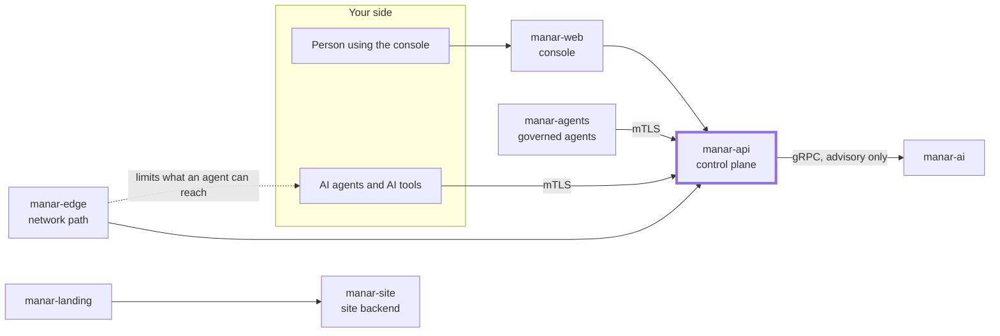

# manar-api

The Manar control plane (NestJS on Fastify, TypeScript).

## Where it fits in Manar

Manar is a control plane that governs AI agents and AI tools: who an agent is, what it may do,
who approves risky actions, and a tamper-evident record of what happened. This repository is the
thick-bordered box of the picture below; the other parts live in their own repositories under
[github.com/manarhq](https://github.com/manarhq).



## What it does

`manar-api` is where Manar's decisions are made. It provides:

- **Tenancy and human sign-in**: a control database plus one database per tenant; people sign in
  through Keycloak (OIDC).
- **Agent identity**: agents enrol with a one-time token and a CSR and receive an X.509
  certificate from an OpenBao-held CA. After enrolment they talk to the mTLS listener on `:3443`
  (`/agent/v1/*`).
- **Authorization**: task delegation and fine-grained checks through OpenFGA, with a
  deterministic policy and risk evaluation that fails closed.
- **Tool gateway and credential broker**: agents never hold the credentials of the tools they
  use; Manar executes the action and records the result.
- **Approvals**: a Temporal-backed human approval engine for risky actions.
- **Audit**: a hash-chained, tamper-evident audit log with evidence export and verification.
- **Kill switches** at five scopes, and an advisory pipeline that calls
  [manar-ai](https://github.com/manarhq/manar-ai) over gRPC. manar-ai is never on the
  authorization decision path.

Each subsystem has a design note in [docs/](docs/). The decisions behind the architecture are in
[docs/adr/](docs/adr/).

## Quickstart (developers)

Needs Node 24, pnpm 11 and Docker.

```bash
pnpm install
cp .env.example .env                       # placeholders only; fill in what your setup needs
pnpm infra:up                              # PostgreSQL, Keycloak, OpenBao, OpenFGA, Temporal, Kafka, Redis, OpenSearch
pnpm infra:openbao-init                    # once per fresh OpenBao volume
pnpm db:migrate:control && pnpm manar tenants:migrate
pnpm start:dev                             # HTTP :3000, agent mTLS :3443
```

Tests:

```bash
pnpm lint && pnpm typecheck
pnpm test          # unit tests
pnpm test:e2e      # needs the stack above
```

`docs/demo.md` walks through a scripted SOC agent scenario end to end (seed a tenant, run the
agent, approve an action, use a kill switch, verify the audit chain) and the automated
acceptance test `test/complete-demo.e2e-spec.ts` runs the same scenario.

Do not use the Compose defaults (dev tokens, local passwords) outside a development machine.

## Licence and links

Licensed under the [Apache License 2.0](LICENSE). Copyright 2026 Fixio; see [NOTICE](NOTICE).
Contributions need a DCO sign-off: [CONTRIBUTING.md](CONTRIBUTING.md). Report vulnerabilities
privately: [SECURITY.md](SECURITY.md). The Manar name and logo are trademarks of Fixio:
[TRADEMARK.md](TRADEMARK.md). Everyone taking part follows the [Code of Conduct](CODE_OF_CONDUCT.md).

Product site: <https://manar.vax.sh>
